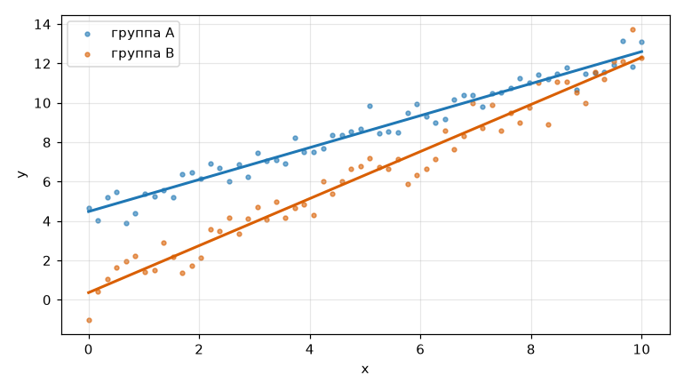
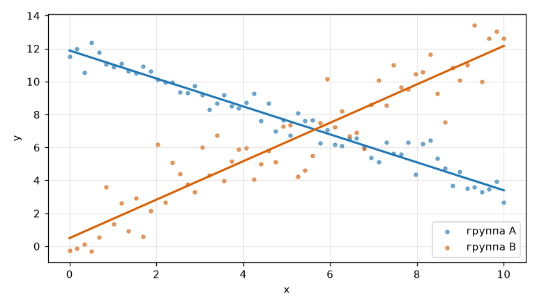
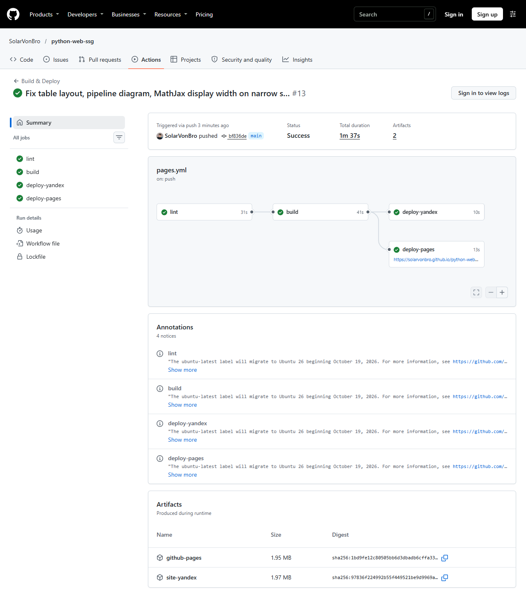

<div class="title-page" align="center">
<p class="tp-org">Министерство науки и высшего образования Российской Федерации<br>федеральное государственное автономное образовательное учреждение высшего образования<br><strong>«Национальный исследовательский университет ИТМО»</strong></p>
<div class="tp-center">
<h1>ОТЧЁТ</h1>
<p>о выполнении задания 1</p>
<p class="tp-topic">«Публикация результатов эксперимента<br>на статическом сайте»</p>
<p class="tp-parts">Исследовательская часть — задание T4 «Модель доставки и безопасность конвейера публикации»<br>Практическая часть — задание P3 «Воспроизводимый конвейер „данные&nbsp;→&nbsp;результат&nbsp;→&nbsp;сайт“»</p>
</div>
<p class="tp-authors">Выполнили:<br>Голиенко Роман<br>Митенева София</p>
<p class="tp-city">Санкт-Петербург<br>2026</p>
</div>

<!-- web-only -->
!!! note "Версия для печати"
    Этот отчёт в формате PDF: [otchet-zadanie-1.pdf](assets/otchet-zadanie-1.pdf) — все ссылки в файле кликабельны.
<!-- /web-only -->

## Введение

Результаты вычислительного эксперимента полезны только тогда, когда их можно найти, проверить и воспроизвести. Статический сайт — простой способ опубликовать такие результаты: он не требует сервера приложений и базы данных, его легко разместить на бесплатном хостинге, а исходные тексты страниц хранятся в той же системе контроля версий, что и код эксперимента. Если сборка сайта автоматизирована, то любое изменение данных сразу и без ручных действий приводит к обновлению графиков и таблиц на опубликованных страницах. Вместе с тем автоматическая публикация сама становится объектом атаки: тот, кто получил доступ к конвейеру сборки, может подменить содержимое сайта.

**Цель работы** — построить статический сайт с воспроизводимым конвейером «данные → расчёт → график и таблица → страница», автоматически публиковать его на двух хостингах и оценить безопасность выбранного способа доставки.

Для достижения цели решались следующие задачи:

1. подготовить набор данных и сценарий расчёта, который строит график и таблицу результатов;
2. сделать расчёт воспроизводимым и не выполнять его повторно, если входные данные не изменились;
3. собрать сайт генератором MkDocs в строгом режиме, при котором любое предупреждение считается ошибкой;
4. настроить непрерывную интеграцию (CI) в GitHub Actions: проверка, сборка и публикация;
5. опубликовать сайт на GitHub Pages и на отечественном хостинге Yandex Object Storage;
6. сравнить способы доставки сайта по объёму прав и последствиям компрометации;
7. обеспечить работу сайта без обращений к внешним сетям доставки контента;
8. зафиксировать измерения и все ошибки, найденные при отладке.

Из списка вариантов выбраны два задания:

- **T4 (исследовательское) — модель доставки и безопасность конвейера публикации.** Его выводы можно сразу применить к собственному конвейеру и проверить на нём.
- **P3 (практическое) — воспроизводимый конвейер «данные → результат → сайт».** Оно выполнимо целиком на собственном сайте, без сторонних платформ, и наглядно демонстрируется изменением данных.

## 1. Средства и общая схема

### 1.1. Выбранные средства

Таблица 1 — Использованные средства

| Средство | Назначение |
|---|---|
| Python 3.14 | сценарий расчёта и метки версии |
| NumPy, pandas, Matplotlib | расчёт линейной регрессии, таблица и график |
| MkDocs с темой Material [1, 2] | генерация статического сайта из файлов Markdown |
| Расширение pymdownx.snippets [3] | вставка в страницы сгенерированных таблиц и графика |
| MathJax 3.2.2 [10] | отображение формул, хранится на самом сайте |
| GNU Make | единая команда сборки `make site` |
| GitHub Actions | непрерывная интеграция: проверка, сборка, публикация |
| GitHub Pages | основной хостинг (HTTPS) |
| Yandex Object Storage | отечественный хостинг статического сайта [8] |

Исходный код: <https://github.com/SolarVonBro/python-web-ssg>. Опубликованный сайт: <https://solarvonbro.github.io/python-web-ssg/> и <http://python-web-ssg-398704.website.yandexcloud.net/>.

### 1.2. Схема конвейера

Конвейер состоит из трёх уровней. На первом лежат исходные данные: файл [`data/measurements.csv`](https://github.com/SolarVonBro/python-web-ssg/blob/main/data/measurements.csv) и номер версии набора в файле [`data/VERSION`](https://github.com/SolarVonBro/python-web-ssg/blob/main/data/VERSION). На втором работают сценарии Python: расчёт создаёт график и таблицы в каталоге `docs/generated/`, а метка версии — таблицу с коммитом, датой сборки и версией данных. На третьем MkDocs собирает из страниц и сгенерированных фрагментов готовый сайт в каталоге `site/`. Все три шага запускаются одной командой:

```text
make site  =  python scripts/run_experiment.py   # расчёт (с кэшем)
            + python scripts/stamp.py            # метка версии
            + mkdocs build --strict              # сборка сайта
```

В CI те же шаги выполняются после каждой отправки коммитов в репозиторий, а для основной ветки к ним добавляется публикация на оба хостинга (раздел 3).

## 2. Практическая часть P3: воспроизводимый конвейер

### 2.1. Данные и модель

Набор данных содержит две группы наблюдений, A и B, по 60 точек в каждой; для каждой точки заданы значение x и измеренное значение y. Для каждой группы методом наименьших квадратов подбирается прямая y = a·x + b, где a — наклон, b — сдвиг. Качество подгонки оценивается двумя показателями: коэффициентом детерминации R² (единица минус отношение суммы квадратов отклонений точек от прямой к сумме квадратов отклонений от среднего) и среднеквадратичной ошибкой RMSE. Описание модели с формулой приведено на странице [P3](results.md).

### 2.2. Сценарий расчёта и кэширование

Сценарий [`scripts/run_experiment.py`](https://github.com/SolarVonBro/python-web-ssg/blob/main/scripts/run_experiment.py) читает файл данных, рассчитывает параметры прямых, сохраняет график `fit.png`, таблицу показателей в форматах CSV и Markdown и фрагмент страницы с графиком.

Чтобы не повторять расчёт без необходимости, сценарий вычисляет хеш SHA-256 от содержимого файла данных и от собственного текста. Хеш записывается в файл `.cache/experiment.json`. При следующем запуске, если хеш совпал и все выходные файлы на месте, расчёт пропускается (в журнале — `CACHE HIT`, попадание в кэш); при любом изменении данных или самого сценария расчёт выполняется заново (`CACHE MISS`, промах). Включение текста сценария в хеш гарантирует, что изменение способа расчёта тоже приведёт к пересчёту.

Первые 12 знаков того же хеша добавляются к адресу картинки: `generated/fit.png?v=<хеш>`. Адрес меняется вместе с данными, поэтому браузер не может показать старый график из своего кэша (раздел 6, запись 9).

### 2.3. Метка версии

Сценарий [`scripts/stamp.py`](https://github.com/SolarVonBro/python-web-ssg/blob/main/scripts/stamp.py) записывает на главную страницу и страницу результатов таблицу из трёх полей: сокращённый хеш коммита, дату и время сборки (UTC) и версию набора данных. Если в рабочем каталоге есть незафиксированные изменения, к хешу добавляется пометка `(+uncommitted)`. По метке на опубликованной странице всегда можно определить, из какого коммита и из какой версии данных она собрана.

### 2.4. Сборка в строгом режиме

Сайт собирается командой `mkdocs build --strict`. В строгом режиме любое предупреждение MkDocs — например, ссылка на несуществующую страницу или отсутствующий фрагмент для вставки — считается ошибкой, и сборка останавливается. Благодаря этому сломанная страница не может попасть на сайт: проверка в CI завершается неуспешно раньше, чем дело доходит до публикации (подраздел 3.5). Все ссылки внутри сайта относительные (`use_directory_urls: true`), поэтому одна и та же сборка работает и в подкаталоге GitHub Pages, и в корне бакета Yandex Object Storage.

### 2.5. Результаты для набора данных 1.1.0

Итоговая версия набора данных — 1.1.0. Для неё получены следующие параметры.

Таблица 2 — Результаты регрессии, набор данных 1.1.0

| Группа | Число точек | Наклон a | Сдвиг b | R² | RMSE |
|---|---|---|---|---|---|
| A | 60 | 0,8122 | 4,478 | 0,9632 | 0,466 |
| B | 60 | 1,1943 | 0,361 | 0,9630 | 0,6872 |



*Рисунок 1 — Наблюдения и подобранные прямые, набор данных 1.1.0*

Обе группы хорошо описываются прямой (R² ≈ 0,96). Страница [P3](results.md) на сайте всегда показывает результаты для текущей версии данных в репозитории; рисунок 1 и таблица 2 зафиксированы для версии 1.1.0.

### 2.6. Демонстрация «данные → коммит → сайт»

Основная демонстрация конвейера выполнена коммитом [`e7943b2`](https://github.com/SolarVonBro/python-web-ssg/commit/e7943b2): версия набора изменена с 1.0.0 на 1.1.0, все значения y группы A увеличены на 3. После отправки коммита CI без каких-либо ручных действий пересчитал результаты и опубликовал сайт: наклон группы A остался прежним (0,8122), а сдвиг изменился с 1,478 на 4,478 — ровно на внесённую величину. Новые значения появились в таблице, на графике и в метке версии (коммит `e7943b2`, набор `1.1.0`).

Сдвиг на 3 единицы на графике заметен слабо, поэтому для устной демонстрации подготовлен тестовый набор **2.0.0**: 120 точек, полученных генератором случайных чисел с фиксированным начальным значением 2026; в группе A значения убывают, в группе B растут, и прямые пересекаются около x ≈ 5,6. Этот набор вставлялся в репозиторий целиком (последний раз — коммит [`281fad2`](https://github.com/SolarVonBro/python-web-ssg/commit/281fad2)), после чего репозиторий возвращался к исходному набору 1.1.0 (коммит [`1276263`](https://github.com/SolarVonBro/python-web-ssg/commit/1276263)).

Таблица 3 — Результаты регрессии, демонстрационный набор 2.0.0

| Группа | Число точек | Наклон a | Сдвиг b | R² |
|---|---|---|---|---|
| A | 60 | −0,8487 | 11,8823 | 0,9514 |
| B | 60 | 1,1668 | 0,4935 | 0,8701 |



*Рисунок 2 — Тот же график для демонстрационного набора 2.0.0: прямые меняют направление и пересекаются*

## 3. Непрерывная интеграция и публикация

### 3.1. Этапы конвейера CI

Сценарий CI описан в файле [`.github/workflows/pages.yml`](https://github.com/SolarVonBro/python-web-ssg/blob/main/.github/workflows/pages.yml) и состоит из четырёх этапов:

```text
отправка коммитов / запрос на слияние (любая ветка)
      │
   [lint]   расчёт + метка версии; mkdocs build --strict
      │     (ошибка или предупреждение → этап неуспешен)
   [build]  кэш .cache и docs/generated (ключ — хеш данных и сценария);
      │     make site → пакет для GitHub Pages; для main — сборка для Яндекса
      ├── [deploy-pages]   только main, не слияние: публикация на GitHub Pages
      └── [deploy-yandex]  только main, не слияние: выгрузка в бакет + проверка
```

Таблица 4 — Поведение CI при разных событиях

| Событие | Что выполняется |
|---|---|
| Отправка коммитов в `main` | проверка → сборка → публикация на GitHub Pages и в Yandex Object Storage |
| Отправка коммитов в другую ветку | проверка → сборка; публикация пропускается |
| Запрос на слияние (pull request) | проверка → сборка; секреты и публикация недоступны |
| Ручной запуск (`workflow_dispatch`) | как отправка коммитов в выбранную ветку |

Сценарию по умолчанию выдано минимальное право — только чтение содержимого репозитория (`contents: read`). Права на публикацию выдаются только этапу `deploy-pages`. Все сторонние действия (actions) закреплены по полному хешу коммита, а не по тегу; номер версии указан рядом в комментарии (подраздел 4.2).

### 3.2. Публикация на GitHub Pages

Публикация выполняется штатными действиями `upload-pages-artifact` и `deploy-pages`. Этап `deploy-pages` получает одноразовый токен OpenID Connect (OIDC) [6] и право `pages: write`; долгоживущих секретов для этого не нужно. Токен действует несколько минут и привязан к окружению `github-pages`, поэтому даже при компрометации этапа им можно только опубликовать страницы, но не изменить репозиторий.

### 3.3. Отечественный хостинг: Yandex Object Storage

В качестве отечественного хостинга использован **Yandex Object Storage** в режиме хостинга статического сайта [8].

Таблица 5 — Параметры размещения в Yandex Object Storage

| Параметр | Значение |
|---|---|
| Бакет | `python-web-ssg-398704`, стандартный класс хранения, публичное чтение, квота 100 МБ |
| Адрес сайта | <http://python-web-ssg-398704.website.yandexcloud.net/> (только HTTP: для HTTPS на этом адресе нужен собственный домен и сертификат) |
| Способ доставки | программный интерфейс S3, команда `aws s3 sync --delete --cache-control no-cache` |
| Учётные данные | ключ сервисного аккаунта `ssg-deployer`; права полного доступа только на этот бакет; ключ хранится в секретах репозитория (`YC_ACCESS_KEY_ID`, `YC_SECRET_ACCESS_KEY`) и в журнале CI маскируется |
| Переменные | `YC_BUCKET`, `YC_SITE_URL` (переменные репозитория) |
| Контроль результата | проверка доступности: до 5 попыток, нужен код ответа 200 и строка `pipeline-ok-p3` на странице результатов, иначе этап завершается ошибкой |

Сайт лежит в корне бакета, поэтому для этой сборки адрес сайта (`site_url`) задаётся адресом бакета; для GitHub Pages собирается отдельный вариант с адресом подкаталога. Флаг `--delete` удаляет из бакета файлы, которых больше нет в сборке, а заголовок `no-cache` заставляет браузер каждый раз сверять файлы с сервером.

### 3.4. Сравнение двух способов развёртывания

Таблица 6 — Сравнение развёртывания (первый запуск с публикацией в Яндекс, коммит [`527dc60`](https://github.com/SolarVonBro/python-web-ssg/commit/527dc60))

| Показатель | GitHub Pages | Yandex Object Storage |
|---|---|---|
| Время этапа публикации | 8 с | 21 с (59 файлов, 5,1 МБ) |
| Механизм | одноразовый токен OIDC и пакет сайта, секретов нет | ключ S3 в секретах, права на один бакет |
| Откат | перезапуск старой сборки или отмена коммита | то же; дополнительно — версионирование бакета, если его включить |
| Протокол | HTTPS | HTTP |
| Средства отладки | журналы GitHub Actions | журналы GitHub Actions, список объектов бакета |

Локальная проверка доставки без CI (библиотека boto3): удаление 80 объектов и загрузка 59 файлов заняли 15,7 с.

### 3.5. Демонстрация защиты от публикации сломанного сайта

В ветке `broken-link` на главную страницу намеренно добавлена ссылка на несуществующую страницу `no-such-page.md`. Запуск CI [43041903241](https://github.com/SolarVonBro/python-web-ssg/actions/runs/43041903241) завершился неуспешно уже на этапе `lint`:

```text
WARNING -  Doc file 'index.md' contains a link 'no-such-page.md', but the target is not found among documentation files.
Aborted with 1 warnings in strict mode!
##[error]Process completed with exit code 1.
```

Строгий режим превратил предупреждение о битой ссылке в ошибку, зависимые этапы `build`, `deploy-pages` и `deploy-yandex` получили статус «пропущен», и на сайт ничего не попало (рисунок 7, приложение А). Успешный запуск с публикацией на оба хостинга — [43041592996](https://github.com/SolarVonBro/python-web-ssg/actions/runs/43041592996) (рисунок 6).

## 4. Исследовательская часть T4: модель доставки и безопасность конвейера

### 4.1. Способы доставки, учётные данные и последствия компрометации

Главный вопрос безопасности публикации — какие учётные данные нужны конвейеру для доставки сайта и что сможет сделать злоумышленник, если их похитит. В таблице 7 сравниваются распространённые способы доставки.

Таблица 7 — Способы доставки сайта

| Способ | Что нужно для доставки | Объём прав | Последствия компрометации |
|---|---|---|---|
| Запись в ветку `gh-pages` (действие `peaceiris/actions-gh-pages`) | `GITHUB_TOKEN` с правом `contents: write` или персональный токен доступа | запись во **весь репозиторий** — код, ветки, теги, сценарии CI, а не только в сайт | подмена кода и сценариев CI, выпуск вредоносной версии; сайт — лишь одно из последствий |
| Действия `upload-pages-artifact` и `deploy-pages` | одноразовый токен OIDC (`id-token: write`) и `pages: write` только на одном этапе; долгоживущего секрета нет | только публикация страниц; токен живёт минуты и привязан к окружению `github-pages` | минимальные: похищать нечего, злоумышленник внутри этапа может опубликовать только страницы |
| Копирование по SSH (`rsync`, `scp`) с ключом развёртывания | закрытый ключ в секретах, файл `known_hosts` | зависит от сервера: при ограничении ключа (`command=`, отдельный корневой каталог) — только каталог сайта; при обычной учётной записи — **вся учётная запись** | запись на сервер от имени пользователя бессрочно, пока ключ не отозван; подмена сайта и использование сервера для дальнейших атак |
| FTP или SFTP | имя пользователя и пароль (в FTP передаются открытым текстом) | как правило, весь домашний каталог учётной записи | пароль часто совпадает с паролем от панели хостинга; FTP перехватывается в сети; для SFTP — как для SSH |
| Программный интерфейс S3 (объектное хранилище) | постоянный ключ доступа и секретный ключ | определяется политикой: при отдельном сервисном аккаунте с правами на один бакет — только этот бакет | перезапись и удаление содержимого бакета; при широкой роли — доступ к другим ресурсам облака |

Вывод: наименьший риск у публикации с одноразовым токеном OIDC — у конвейера нет хранимого секрета, который можно унести. Для доставки по SSH риск снижается отдельным ключом, ограниченным **только каталогом сайта** (`command="rrsync …"`, `restrict` в `authorized_keys`), отдельной учётной записью и возможностью быстро отозвать ключ. В этой работе для GitHub Pages применён способ с OIDC, а для Yandex Object Storage — ключ сервисного аккаунта с правами только на один бакет.

### 4.2. Ответы на вопросы задания

**Почему секреты недоступны сценариям, запущенным по запросу на слияние из форка?** Такой сценарий выполняется по коду, который прислал внешний автор, и этот автор может изменить сам сценарий, например добавить отправку секрета на свой сервер. Поэтому GitHub для событий `pull_request` из форков не передаёт секреты и выдаёт `GITHUB_TOKEN` только на чтение [5]. Событие `pull_request_target` секреты передаёт, но выполняется в контексте базовой ветки; его нельзя сочетать с получением и запуском кода из присланного изменения. В нашем сценарии публикация выполняется только для ветки `main` и никогда — для запросов на слияние.

**Зачем закреплять действия по хешу коммита, а не по тегу?** Тег — подвижная ссылка: владелец действия или тот, кто получил доступ к его репозиторию, может перенести тег `v4` на другой коммит. Хеш коммита неизменяем. Поэтому в `pages.yml` все действия закреплены по полному хешу, а номер версии указан в комментарии; обновлять закрепления можно через Dependabot.

**Что означает атака через цепочку поставок (заражённое действие) для опубликованного сайта?** Заражённое действие выполняется внутри этапа CI с доступом к его секретам и токену. Пример — инцидент с действием `tj-actions/changed-files` в марте 2025 года: вредоносный код выводил секреты в журнал сборки, а теги действия были перенаправлены на вредоносный коммит [7]. Для сайта это означает кражу ключа или токена публикации, внедрение в собранные страницы постороннего сценария (кража данных посетителей, скрытый майнинг, перенаправления) и подмену файлов для скачивания. Сайт при этом выглядит «законным», потому что опубликован штатным конвейером. Меры защиты: закрепление действий по хешу, минимальные права (`permissions`), разделение сборки и публикации на разные этапы, окружения с ручным подтверждением, проверка содержимого `site/` перед публикацией.

**Как настроить `known_hosts`, не отключая проверку ключа сервера?** Отпечаток ключа сервера получают один раз по доверенному каналу: командой `ssh-keyscan -p ПОРТ сервер`, после чего сверяют вывод `ssh-keygen -lf` с отпечатком, который сообщил администратор. Проверенную строку кладут в секрет `KNOWN_HOSTS`, а в сценарии записывают её в `~/.ssh/known_hosts` и оставляют строгую проверку ключа (`StrictHostKeyChecking=yes`, значение по умолчанию). Нельзя использовать `StrictHostKeyChecking=no` или вызывать `ssh-keyscan` прямо в сценарии без сверки — иначе атака «человек посередине» останется незамеченной.

### 4.3. Работа сайта без внешних сетей доставки контента

Каждый внешний ресурс (шрифт, библиотека с сети доставки контента, CDN) — это дополнительный поставщик, которому сайт доверяет: при его компрометации на страницу можно внедрить посторонний код, а при недоступности — сломать отображение. Поэтому сайт сделан полностью автономным:

- в настройках темы указано `font: false` — шрифты Google не загружаются, используются системные;
- MathJax 3.2.2 в варианте с выводом в SVG (без внешних файлов шрифтов) хранится в каталоге `docs/javascripts/` и раздаётся с того же сервера;
- значки темы Material встроены в страницу как векторные изображения SVG, поиск работает локально (библиотека lunr).

Проверка выполнена в браузере Chrome без графического интерфейса, которому было запрещено разрешать любые доменные имена, кроме `127.0.0.1` (`--host-resolver-rules="MAP * ~NOTFOUND, EXCLUDE 127.0.0.1"`): формулы на странице [P3](results.md) отрисовались (в модели документа два элемента `mjx-container`), шрифты и значки отображаются штатно.

Таблица 8 — Объём загрузки с внешними ресурсами и без них

| Ресурс | Вариант с CDN | Локально | Изменение |
|---|---|---|---|
| Шрифты Roboto и Roboto Mono (10 файлов, верхняя оценка) | ≈ 369 КБ с `fonts.gstatic.com` | 0 (системные шрифты) | −369 КБ, −10 запросов |
| MathJax `tex-svg.js` | ≈ 0,66 МБ в сжатом виде с CDN (кэш общий для разных сайтов) | 2,11 МБ без сжатия / 0,68 МБ в сжатом виде с нашего сервера | +0,68 МБ к первой загрузке страницы с формулами |
| HTML страницы результатов | 17,1 КБ / 4,4 КБ в сжатом виде | то же | 0 |
| Стили и сценарии темы | 137,6 + 114,1 КБ (22,6 + 34,8 КБ в сжатом виде) | то же | 0 |

Итог: внешних запросов на страницах нет; первая загрузка страницы с формулами составляет около 0,77 МБ в сжатом виде, без формул — около 0,09 МБ. На страницах без формул MathJax можно не подключать и сэкономить 0,68 МБ.

### 4.4. Меры безопасности, применённые в конвейере

Таблица 9 — Применённые меры

| Мера | Реализация | От чего защищает |
|---|---|---|
| Публикация на GitHub Pages без хранимого секрета | одноразовый токен OIDC, право `pages: write` только у этапа `deploy-pages` | кража долгоживущего ключа публикации |
| Минимальные права сценария | `permissions: contents: read` для всех этапов по умолчанию | изменение репозитория скомпрометированным этапом |
| Закрепление действий по хешу | полный хеш коммита для каждого действия | подмена действия переносом тега |
| Публикация только из `main` и не для запросов на слияние | условия `if:` у этапов публикации | публикация чужого кода, утечка секретов через форк |
| Ключ Яндекса с узкими правами | сервисный аккаунт с доступом только к одному бакету; квота бакета 100 МБ | доступ к другим ресурсам облака, неограниченный рост хранения |
| Строгая сборка | `mkdocs build --strict` в отдельном этапе проверки | публикация сломанного сайта |
| Проверка после публикации | код 200 и контрольная строка на сайте в Яндексе | незамеченный сбой выгрузки |
| Отказ от внешних CDN | локальные MathJax и шрифты | внедрение кода через сторонний ресурс, зависимость от его доступности |

## 5. Измерения

### 5.1. Локальная сборка

Условия: Windows 10, Python 3.14, сборка на рабочем компьютере командой `make site`.

Таблица 10 — Время локальной сборки

| Сценарий | Расчёт эксперимента | Сборка целиком (`make site`) |
|---|---|---|
| Первая сборка, кэша нет | 1,61 с (промах кэша) | 3,31 с |
| Повторная сборка, данные не менялись | 0,002 с (попадание в кэш) | 1,64 с |
| После изменения данных | 1,63 с (промах кэша) | 3,17 с |

Кэш ускоряет расчёт примерно в 800 раз, а сборку целиком — вдвое.

### 5.2. Сборка в CI

Условия: стандартные машины GitHub Actions (Ubuntu), Python 3.14.

Таблица 11 — Время этапов CI

| Запуск | Проверка | Сборка | Публикация на GitHub Pages | Установка пакетов (в сборке) | Расчёт эксперимента |
|---|---|---|---|---|---|
| Первый, кэши пусты | 32 с | 45 с | 10 с | 23 с | выполнен (промах) |
| Те же данные, кэши есть | 29 с | 28 с | 11 с | 19 с | пропущен (шаг сборки 1 с вместо 3 с) |
| Данные версии 1.1.0 (ключ кэша изменился) | 29 с | 36 с | 10 с | 19 с | выполнен заново (шаг сборки 3 с) |

Кэш расчёта экономит около 2 с из 3 с шага сборки, кэш пакетов — около 4 с из 23 с: основное время занимает установка готовых пакетов. На таком объёме данных выигрыш невелик; кэш оправдан при тяжёлых расчётах. Локально выигрыш расчёта заметнее: 1,61 с против 0,002 с.

## 6. Отладка

В таблице 12 перечислены все ошибки, найденные при выполнении работы, в том числе ошибки в собственных проверках исполнителей. Для каждой указаны предположение о причине, способ проверки и принятое решение.

Таблица 12 — Ошибки, найденные при отладке

| № | Ошибка | Предположение | Проверка | Решение |
|---|---|---|---|---|
| 1 | `rm: cannot remove 'site': Device or resource busy` при `make clean` | каталог `site/` удерживает процесс — запущенный для проверки локальный сервер `python -m http.server`, рабочий каталог которого `site` | поиск процессов `http.server`, повторное удаление после остановки | остановить сервер; запускать его с ключом `--directory`, а не переходом в каталог `site` |
| 2 | `cp: cannot create regular file '.cache/m.bak'`: после `make clean` каталога нет, а следующий шаг уже изменил файл данных | цепочка команд продолжилась после ошибки, резервная копия не создана | `head` и `sha256sum` файла данных | данные пересозданы тем же генератором с тем же начальным значением 42 (хеш совпал); в командах добавлены `mkdir -p` и `set -e` |
| 3 | Вывод сценария в консоли нечитаем: вместо русских букв — знаки замены | консоль Windows работает в кодировке cp866/cp1251, а Python выводит UTF-8 | запуск с `PYTHONIOENCODING=utf-8` | переменная задаётся при сборке; в CI (Linux) проблемы нет |
| 4 | `curl: (7)`, код `000` при проверке страницы | сервер запущен в фоне, но не успел стартовать, а затем завершился вместе с родительской оболочкой | журнал `http.server`, повторный запрос после паузы | перед запросом ждать готовности сервера |
| 5 | Запуск CI на GitHub неуспешен, этапов 0, сценарий не стартовал | файл сценария стал некорректным YAML: при правке файла программой последовательность `\n` внутри `printf '%s\n'` превратилась в настоящий перевод строки | `yaml.safe_load` локально: `could not find expected ':'`, строка 90 | экранирование исправлено; перед отправкой файл сценария проверяется разбором YAML (pyyaml) |
| 6 | На опубликованном сайте формула показана исходным текстом LaTeX, хотя проверка «на странице 2 контейнера `mjx-container`» прошла | настройка MathJax неверна: оболочка Bash превратила `\\` в `\`, и разделителями формул стали обычные круглые скобки; найденные 2 контейнера — это выражение в скобках, а не формулы | снимок экрана страницы, чтение `mathjax-config.js`, поиск `frac{` в документе после отрисовки | файл записан заново с правильным экранированием; проверка усилена: в документе нет `frac{`, есть строчные и выделенные формулы |
| 7 | После загрузки `yc storage s3 cp --recursive site/ s3://…/` вложенные страницы отдают 404; в журнале `upload: site\search\search_index.json to s3://…/search\search_index.json` | утилита `yc` в Windows переносит обратную косую черту в имя объекта, а в S3 разделитель — прямая косая черта | запросы `curl` к вложенным адресам, вывод команды, список объектов | загрузка через интерфейс S3 (boto3 локально, `aws s3 sync` в CI) с правильными именами; ошибочные объекты удалены (80 штук) |
| 8 | `yc … failed to initialize SDK: … DeadlineExceeded` | сеть не блокирует Яндекс (соединение с `api.cloud.yandex.net:443` устанавливается), сбой временный | `Test-NetConnection`, `yc --debug`, повтор команды | повтор с 3–4 попытками |
| 9 | После изменения данных (репетиция демонстрации, коммит [`0ffe2ab`](https://github.com/SolarVonBro/python-web-ssg/commit/0ffe2ab)) таблица и метка версии на сайте новые, а график старый | адрес картинки всегда `generated/fit.png`, и браузер берёт её из кэша: GitHub Pages отдаёт `max-age=600`, Яндекс — без заголовка `Cache-Control`, и браузер сам решает хранить файл часами | `curl -I` (дата изменения совпала с публикацией); хеш файла на обоих хостингах отличается от старого; на картинке с сервера есть новая точка — значит, сборка верна, а старый график показывает кэш браузера | `run_experiment.py` пишет фрагмент страницы с адресом `fit.png?v=<хеш входных данных>`; выгрузка в Яндекс с заголовком `no-cache` (коммит [`077c10d`](https://github.com/SolarVonBro/python-web-ssg/commit/077c10d)) |

## 7. Стоимость и ресурсы

Для сайта в Yandex Cloud созданы только один бакет (около 6 МБ) и сервисный аккаунт с одним ключом. Платные функции (холодное и интеллектуальное хранение, версионирование, журналы бакета, виртуальные машины, публичные IP-адреса, бессерверные функции) не включались. По странице тарифов Яндекса [9] ежемесячно бесплатны 1 ГБ хранения, 10 000 операций записи и получения списка объектов, 100 000 операций чтения и 100 ГБ исходящего трафика; сайт укладывается в эти лимиты. Квота бакета 100 МБ дополнительно ограничивает рост хранения. GitHub Pages и GitHub Actions для открытого репозитория бесплатны.

## Заключение

В работе построен статический сайт на MkDocs с воспроизводимым конвейером «данные → расчёт → график и таблица → страница» и автоматической публикацией на GitHub Pages и в Yandex Object Storage. Практически подтверждено:

- изменение данных одним коммитом без ручных действий приводит к пересчёту результатов и обновлению сайта на обоих хостингах (сдвиг группы A 1,478 → 4,478 в коммите `e7943b2`; демонстрационный набор 2.0.0);
- кэширование по хешу данных и сценария исключает повторный расчёт: локально 1,61 с против 0,002 с;
- строгая сборка не допускает публикации сломанного сайта: запуск с битой ссылкой остановился на этапе проверки, и на сайт ничего не попало;
- метка версии на каждой странице однозначно связывает опубликованный результат с коммитом и версией данных;
- сайт не обращается к внешним ресурсам.

Исследование способов доставки показало, что наименьший риск у публикации с одноразовым токеном OIDC: у конвейера нет секрета, который можно похитить. Остальные способы требуют хранимого ключа, и их риск определяется тем, насколько сужены права этого ключа. В работе ключ Яндекса ограничен одним бакетом, все действия CI закреплены по хешу коммита, права сценария минимальны, а публикация запрещена для запросов на слияние.

Ограничения: сайт в Yandex Object Storage доступен только по HTTP (для HTTPS нужен собственный домен); на малом объёме данных выигрыш от кэша в CI невелик; измерения времени сделаны однократно.

## Список использованных источников

1. MkDocs. Генератор статических сайтов для документации. — URL: <https://www.mkdocs.org/>
2. Material for MkDocs. Тема оформления. — URL: <https://squidfunk.github.io/mkdocs-material/>
3. PyMdown Extensions. Расширение Snippets. — URL: <https://facelessuser.github.io/pymdown-extensions/extensions/snippets/>
4. GitHub Docs. Публикация GitHub Pages собственным сценарием CI. — URL: <https://docs.github.com/en/pages/getting-started-with-github-pages/using-custom-workflows-with-github-pages>
5. GitHub Docs. Безопасное использование GitHub Actions. — URL: <https://docs.github.com/en/actions/reference/security/secure-use>
6. GitHub Docs. OpenID Connect в GitHub Actions. — URL: <https://docs.github.com/en/actions/concepts/security/openid-connect>
7. GitHub Advisory Database. GHSA-mrrh-fwg8-r2c3: компрометация действия tj-actions/changed-files. — URL: <https://github.com/advisories/GHSA-mrrh-fwg8-r2c3>
8. Yandex Cloud. Object Storage: хостинг статического сайта. — URL: <https://yandex.cloud/ru/docs/storage/concepts/hosting>
9. Yandex Cloud. Цены. — URL: <https://yandex.cloud/ru/prices>
10. MathJax. Библиотека отображения формул. — URL: <https://www.mathjax.org/>

## Приложение А. Снимки экрана


*Рисунок 3 — Страница P3 на GitHub Pages, экран компьютера*


*Рисунок 4 — Страница P3 на экране шириной 390 пикселей (эмуляция устройства в Chrome, вся высота страницы)*


*Рисунок 5 — Страница P3 в Yandex Object Storage*



*Рисунок 6 — Успешный запуск CI: проверка, сборка, публикация в Yandex Object Storage и на GitHub Pages*


*Рисунок 7 — Намеренно неуспешный запуск (ветка `broken-link`): проверка не прошла, остальные этапы пропущены*

## Приложение Б. Ссылки на материалы работы

Таблица 13 — Материалы работы

| Что | Ссылка |
|---|---|
| Репозиторий | <https://github.com/SolarVonBro/python-web-ssg> |
| Сайт на GitHub Pages | <https://solarvonbro.github.io/python-web-ssg/> |
| Сайт в Yandex Object Storage | <http://python-web-ssg-398704.website.yandexcloud.net/> |
| Страница результатов P3 | [results.md](results.md) |
| Страница исследования T4 | [research-t4.md](research-t4.md) |
| Сценарий CI | [`.github/workflows/pages.yml`](https://github.com/SolarVonBro/python-web-ssg/blob/main/.github/workflows/pages.yml) |
| Сценарии расчёта и метки версии | [`scripts/run_experiment.py`](https://github.com/SolarVonBro/python-web-ssg/blob/main/scripts/run_experiment.py), [`scripts/stamp.py`](https://github.com/SolarVonBro/python-web-ssg/blob/main/scripts/stamp.py) |
| Настройки сайта | [`mkdocs.yml`](https://github.com/SolarVonBro/python-web-ssg/blob/main/mkdocs.yml), [`Makefile`](https://github.com/SolarVonBro/python-web-ssg/blob/main/Makefile) |
| Данные | [`data/measurements.csv`](https://github.com/SolarVonBro/python-web-ssg/blob/main/data/measurements.csv), [`data/VERSION`](https://github.com/SolarVonBro/python-web-ssg/blob/main/data/VERSION) |
| Ветка с намеренной ошибкой | [`broken-link`](https://github.com/SolarVonBro/python-web-ssg/tree/broken-link) |
| Успешный запуск CI с публикацией в Яндекс | [43041592996](https://github.com/SolarVonBro/python-web-ssg/actions/runs/43041592996) |
| Намеренно неуспешный запуск CI | [43041903241](https://github.com/SolarVonBro/python-web-ssg/actions/runs/43041903241) |
