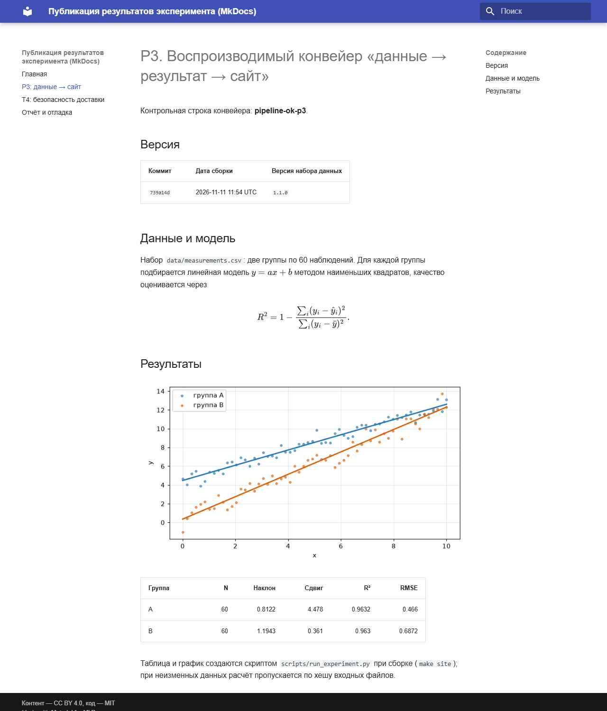
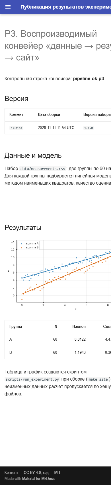
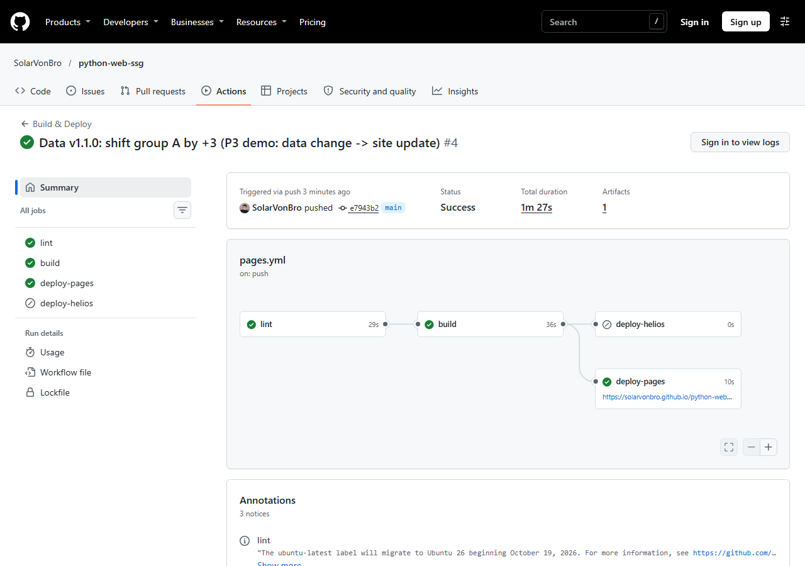
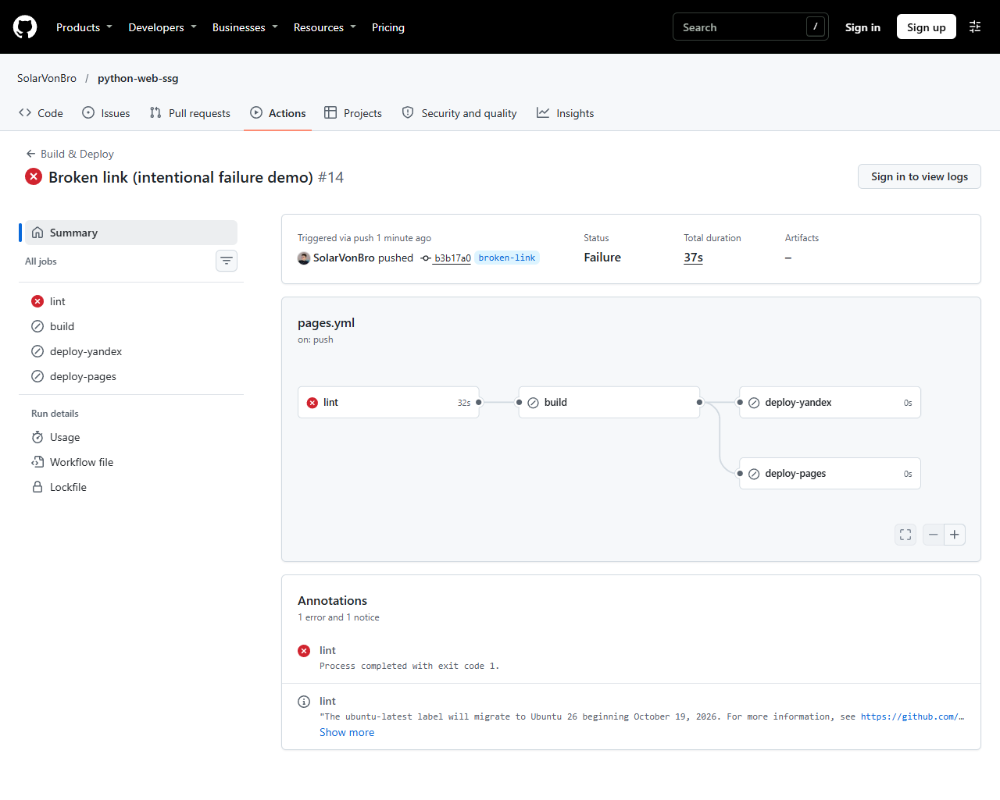

# Отчёт и отладка

## Выбранные задания

- Исследовательское: **T4** — модель доставки и безопасность пайплайна ([страница](research-t4.md)).
- Практическое: **P3** — конвейер «данные → результат → сайт» ([страница](results.md)).
- Выбор: оба задания полностью выполнимы на собственном сайте без сторонних платформ.

## Измерения P3 (Windows 10, Python 3.14, локально)

| Сценарий | Расчёт эксперимента | `make site` целиком |
|---|---|---|
| Холодная сборка (нет кэша) | 1,61 с (CACHE MISS) | 3,31 с |
| Повторная сборка (кэш по хешу данных) | 0,002 с (CACHE HIT) | 1,64 с |
| После изменения данных | 1,63 с (CACHE MISS) | 3,17 с |

Выигрыш от кэша: расчёт ускоряется ≈ в 800 раз, сборка — вдвое. После изменения
данных (группа A: y + 3, версия набора 1.1.0) наклон остался 0,8122, а сдвиг
изменился с 1,478 до 4,478 — новые значения попали на график и в таблицу.
Метка версии (коммит, дата, версия набора данных) выводится на главной и на странице P3.

## Отладка

| # | Ошибка | Гипотеза | Проверка | Решение |
|---|---|---|---|---|
| 1 | `rm: cannot remove 'site': Device or resource busy` при `make clean` | Каталог `site/` удерживает процесс — запущенный для проверки `python -m http.server` с cwd=`site` | Поиск процессов `http.server`, повторный `rm` после остановки | Остановить сервер, запускать его с `--directory`, а не `cd site` |
| 2 | `cp: cannot create regular file '.cache/m.bak'` — после `make clean` каталога нет, а следующий шаг уже изменил `data/measurements.csv` | Цепочка команд продолжилась после ошибки, резервная копия не создана | `head`/`sha256sum` данных | Данные пересозданы тем же генератором с seed=42 (хеш совпал), в скриптах добавлены `mkdir -p` и `set -e` |
| 3 | Вывод скрипта «кракозябрами» (`� �������� ������`) | Консоль Windows в cp866/cp1251, Python пишет UTF-8 | `PYTHONIOENCODING=utf-8` | Переменная задана в сборке; в CI (Linux) проблемы нет |
| 4 | `curl: (7)`/код `000` при проверке страницы | Сервер запущен в фоне, но не успел стартовать, затем процесс был завершён вместе с подоболочкой | Лог `http.server`, повторный запрос после паузы | Запуск с `sleep`/ожиданием готовности перед запросом |
| 5 | Run на GitHub: `failure`, **0 jobs**, workflow не стартовал | Невалидный YAML: при правке файла скриптом `
` внутри `printf '%s
'` стал реальным переводом строки | `yaml.safe_load` локально: `could not find expected ':'`, line 90 | Экранирование исправлено, в процесс добавлена локальная проверка YAML (pyyaml) перед пушем |
| 6 | На опубликованном сайте формула показана сырым LaTeX (`\[ R^2 = 1 - \frac{...`), хотя проверка «2 контейнера `mjx-container`» прошла | Конфиг MathJax неверен: оболочка Bash схлопнула `\\` в `\`, и разделителями формул стали обычные скобки; найденные 2 контейнера — это `(y_i - \hat y_i)`, а не формулы | Скриншот страницы, `cat docs/javascripts/mathjax-config.js`, поиск `frac{` в DOM после отрисовки | Файл записан инструментом Write с корректным экранированием; проверка усилена: в DOM нет `frac{`, есть inline- и display-контейнеры |

## Ссылки

| Что | Ссылка |
|---|---|
| Репозиторий | <https://github.com/SolarVonBro/python-web-ssg> |
| Сайт на GitHub Pages | <https://solarvonbro.github.io/python-web-ssg/> |
| Сайт на Helios ИТМО | _ожидает доступов (см. ниже)_ |
| Workflow | `.github/workflows/pages.yml` |
| Ветка с намеренной ошибкой | `broken-link` |

## Пайплайн

```
push / PR (любая ветка)
      │
   [lint]  python scripts/run_experiment.py + stamp.py; mkdocs build --strict
      │  (ошибка/предупреждение → job красный, дальше не идёт)
   [build] кэш .cache+docs/generated (ключ = хеш data/** и скрипта),
      │    make site → артефакт Pages; для main + HELIOS_URL — ещё и site-helios
      ├── [deploy-pages]  только main и не PR: OIDC, upload/deploy-pages
      └── [deploy-helios] только main и не PR и если задан HELIOS_URL:
                          rsync по SSH (known_hosts закреплён) + healthcheck
```

| Событие | Поведение |
|---|---|
| push в `main` | lint → build → deploy-pages (→ deploy-helios, если настроен) |
| push в другую ветку | lint → build, деплой пропущен (`skipped`) |
| pull request | lint → build; секреты и деплой недоступны |
| `workflow_dispatch` | ручной запуск, как push в выбранную ветку |

## Замеры CI (GitHub-hosted ubuntu-latest, Python 3.14)

| Запуск | lint | build | deploy-pages | pip install (в build) | Расчёт эксперимента |
|---|---|---|---|---|---|
| Первый (кэши пусты) | 32 с | 45 с | 10 с | 23 с | выполнен (MISS) |
| Те же данные, кэши есть | 29 с | 28 с | 11 с | 19 с | пропущен (HIT, шаг `Build` 1 с против 3 с) |
| Данные v1.1.0 (ключ кэша изменился) | 29 с | 36 с | 10 с | 19 с | пересчитан (MISS, `Build` 3 с) |

Вывод: кэш расчёта экономит ≈ 2 с из ≈ 3 с шага сборки; кэш pip — ≈ 4 с из 23 с
(установка wheels доминирует). На данном объёме данных выигрыш мал: кэш
оправдан при тяжёлых расчётах; локально выигрыш расчёта 1,61 с → 0,002 с.

## Демонстрация «данные → push → сайт» (P3)

Коммит `e7943b2`: версия набора 1.0.0 → 1.1.0, значения группы A сдвинуты на +3.
После пуша без ручных действий workflow пересобрал и опубликовал сайт:
сдвиг группы A 1,478 → **4,478**, метка версии: коммит `e7943b2`, набор `1.1.0`.

## Скриншоты

Сайт (десктоп и мобильное разрешение 390 px):





Примечание: headless Chrome не создаёт окно уже ~500 px, поэтому снимок «390 px» обрезан справа; это артефакт съёмки, а не вёрстки (Material адаптивен, меню свёрнуто в «гамбургер»). Полноценную проверку на устройстве/эмуляторе при необходимости нужно повторить.

Успешный запуск (`e7943b2`) и намеренно проваленный (ветка `broken-link`):





Разбор лога проваленного запуска (job `lint`, шаг `mkdocs build --strict`):

```
WARNING -  Doc file 'index.md' contains a link 'no-such-page.md', but the target is not found among documentation files.
Aborted with 1 warnings in strict mode!
##[error]Process completed with exit code 1.
```

`--strict` превращает предупреждение о битой ссылке в ошибку; зависимые job
`build`, `deploy-pages`, `deploy-helios` получили статус `skipped`, на сайт ничего не попало.

## Helios ИТМО (не выполнено)

Workflow содержит job `deploy-helios` (rsync по SSH с отдельным deploy-ключом,
закреплённый `known_hosts`, healthcheck на код 200 и строку `pipeline-ok-p3`).
Job включается переменной репозитория `HELIOS_URL` и секретами `HELIOS_HOST`,
`HELIOS_PORT`, `HELIOS_USER`, `HELIOS_PATH`, `HELIOS_SSH_KEY`, `HELIOS_KNOWN_HOSTS`.
Без данных доступа к Helios развернуть и проверить сайт нельзя: сборка под подкаталог
Helios и сравнение с GitHub Pages выполнены не будут.
